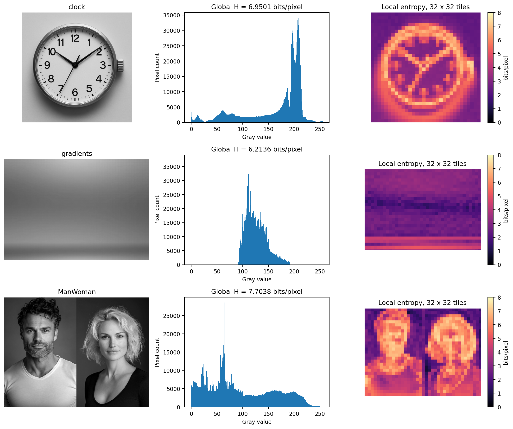
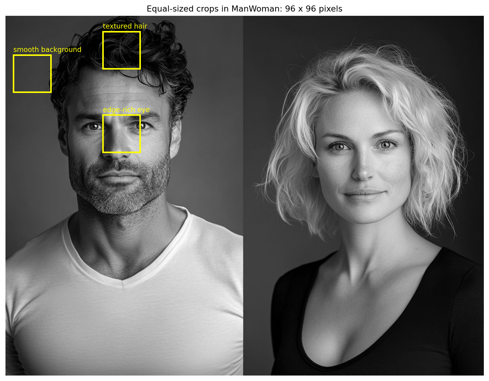
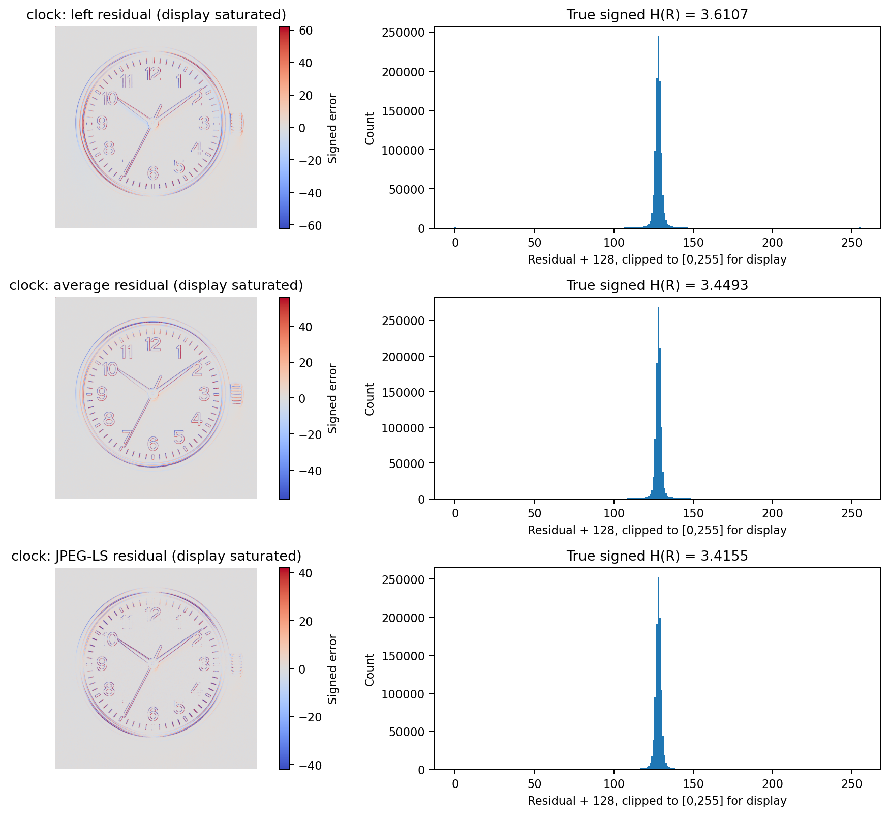
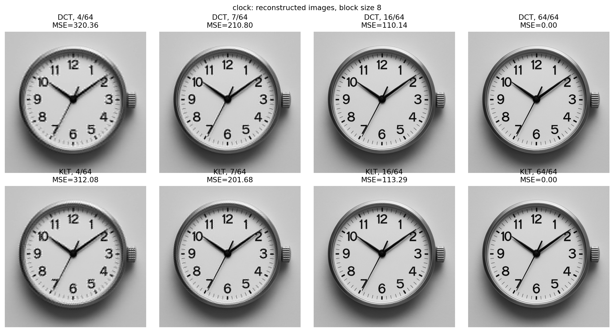
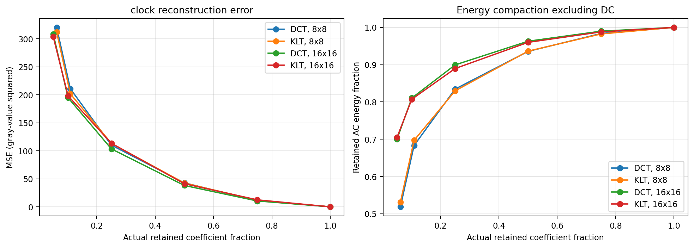
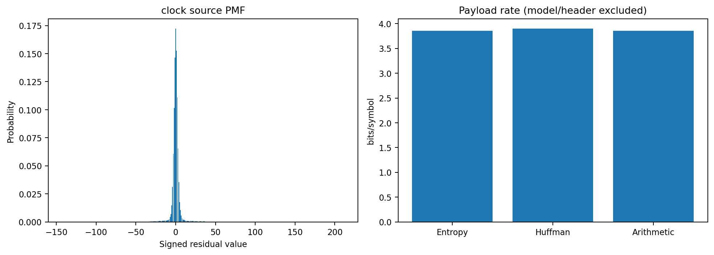

# Image Prediction, Transform and Entropy Coding

This lab examines how image statistics change after spatial prediction, transform coding, and lossless entropy coding.

Three grayscale images, `clock`, `gradients`, and `ManWoman`, were used to compare images with different intensity distributions and spatial structures.

The experiments cover global and local entropy, prediction residuals, DCT and KLT transformations, and Huffman and arithmetic coding.

## 1. Global and Local Image Entropy

### 1.1 Global entropy

The three images were loaded in grayscale, and their pixel intensity distributions were analyzed using 256-bin histograms.

Shannon entropy was calculated from each normalized histogram to estimate the average information associated with a pixel value.

The measured results were:

| Image | Dimensions | Entropy (bits/pixel) |
|---|---|---:|
| clock | 1024 × 1024 | 6.950 |
| gradients | 846 × 1214 | 6.214 |
| ManWoman | 928 × 1232 | 7.704 |

Among the three images, `ManWoman` had the highest global entropy, while `gradients` had the lowest.

These values describe the uncertainty of the pixel intensity distributions. They do not directly measure the visual complexity of the images.

### 1.2 Local entropy

Local entropy was calculated using non-overlapping **32 × 32 image tiles**.

Each tile was processed separately to estimate how the pixel intensity distribution changed across different image regions.

The calculated values were displayed as entropy maps.

The maps showed that entropy was not distributed uniformly across an image.

Smooth areas generally had more concentrated intensity distributions, while regions containing edges or texture could have more varied intensity values.

### 1.3 Entropy of selected image regions

Three **96 × 96** regions were extracted from `ManWoman`:

- Smooth background
- Eye region
- Textured hair

The measured entropies were:

| Region | Entropy (bits/pixel) |
|---|---:|
| Smooth background | 3.383 |
| Eye region | 7.568 |
| Textured hair | 5.466 |

The eye region had the highest entropy among these three crops.

The comparison showed that local image statistics can vary considerably even within the same image. A single global entropy value does not capture these regional differences.

## 2. Spatial Prediction and Residual Entropy

### 2.1 Prediction methods

Three causal spatial predictors were implemented:

1. Left-neighbor prediction
2. Average-neighbor prediction
3. JPEG-LS-style prediction

Each method estimated the current pixel using previously available neighboring pixels.

The residual was calculated as:

\[
e(i,j)=x(i,j)-\hat{x}(i,j)
\]

where:

- \(x(i,j)\) is the original pixel.
- \(\hat{x}(i,j)\) is the predicted pixel.
- \(e(i,j)\) is the signed prediction residual.

Image boundaries were handled separately to ensure the prediction process could be reversed correctly.

The residuals were stored as signed values instead of being clipped to the 8-bit image range.

### 2.2 Residual entropy comparison

The residual distributions were analyzed to determine whether prediction reduced the uncertainty compared with the original image.

For the `clock` image:

| Representation | Entropy (bits/pixel) |
|---|---:|
| Original image | 6.950 |
| Left predictor residual | 3.611 |
| Average predictor residual | 3.449 |
| JPEG-LS predictor residual | 3.415 |

All three predictors produced residual distributions with lower entropy than the original pixel distribution.

The JPEG-LS predictor achieved the lowest residual entropy for `clock`, although the difference from the average predictor was relatively small.

The same prediction methods were also evaluated on `gradients` and `ManWoman`.

The comparison demonstrated how the effectiveness of a predictor depends on the local image structure.

### 2.3 Conditional entropy

The conditional entropy of a pixel given its left neighbor was also estimated using horizontally adjacent pixel pairs.

This was compared with the entropy of the residual obtained using left-neighbor prediction.

For `gradients`:

| Measurement | Entropy |
|---|---:|
| Conditional entropy | 1.218 bits |
| Left-prediction residual entropy | 1.223 bits |

The two values were close but not identical.

Conditional entropy describes the remaining uncertainty when the neighboring pixel is known, while residual entropy measures the distribution of the prediction errors after applying a particular predictor.

## 3. DCT and KLT Transform Coding

### 3.1 Block-based transformation

The transform experiments were performed on resized grayscale images using two block sizes:

- 8 × 8
- 16 × 16

Two transforms were compared:

- Discrete Cosine Transform (DCT)
- Karhunen-Loève Transform (KLT)

Each block was transformed into a set of coefficients.

The reconstruction experiments then examined how much image information could be retained when only a fraction of those coefficients was used.

### 3.2 DCT

The two-dimensional DCT was applied independently to each image block.

The transform separates block information into coefficients representing different spatial frequency components.

The experiment retained approximately:

- 5%
- 10%
- 25%
- 50%
- 75%
- 100%

of the available coefficients.

The actual retained percentage was recorded because each block contains a fixed number of coefficients.

Reconstructed images were compared visually, and reconstruction error was measured using MSE.

For the `clock` image with 8 × 8 blocks:

| Retained coefficients | Percentage | MSE |
|---|---:|---:|
| 4 of 64 | 6.25% | 320.36 |
| 16 of 64 | 25% | 110.14 |

Retaining more coefficients reduced the reconstruction error because more of the original block information was preserved.

### 3.3 KLT

The KLT basis was calculated from the image patches used in the experiment.

A constant DC basis was retained for the block mean, while the remaining basis directions were derived from the statistics of the zero-mean patches.

The same coefficient-retention percentages were tested.

This allowed the DCT and KLT to be compared under similar reconstruction conditions.

The comparison focused on how effectively each transform concentrated image information into a limited number of coefficients.

### 3.4 Reconstruction measurements

Two measurements were used:

- Mean Squared Error (MSE)
- Retained coefficient energy

MSE measured the difference between the original and reconstructed images.

Retained coefficient energy indicated how much of the transformed signal energy was represented by the selected coefficients.

The experiments evaluated the trade-off between retaining fewer coefficients and preserving reconstruction quality.

The KLT basis was learned from the tested images, so the cost of storing or transmitting that basis was not included in the reconstruction measurements.

Therefore, the results compare transform behavior rather than the complete bit rate of a compression system.

## 4. Huffman and Arithmetic Coding

### 4.1 Preparing the residual data

Lossless entropy coding was applied to JPEG-LS prediction residuals.

For each image, a central **256 × 256 crop** was selected.

The residual symbols were encoded using:

- Static Huffman coding
- Finite-precision arithmetic coding

Both coding methods used the same empirical symbol-frequency model.

After encoding, the sequences were decoded and compared with the original residual data to verify lossless recovery.

### 4.2 Huffman coding

Huffman coding assigns variable-length binary codewords to symbols based on their probabilities.

More frequent residual values receive shorter codewords, while less frequent values generally receive longer ones.

The average number of encoded bits per residual symbol was calculated for each image.

### 4.3 Arithmetic coding

Arithmetic coding was implemented using the same residual distributions.

Instead of assigning a separate integer-length codeword to every symbol, arithmetic coding represents a sequence using progressively refined probability intervals.

The resulting bit lengths were measured and compared with entropy and Huffman coding.

### 4.4 Coding results

| Image | Residual entropy | Huffman bits/symbol | Arithmetic bits/symbol |
|---|---:|---:|---:|
| clock | 3.858 | 3.901 | 3.858 |
| gradients | 1.156 | 1.410 | 1.156 |
| ManWoman | 2.779 | 2.795 | 2.779 |

Arithmetic coding achieved values very close to the residual entropy for all three images.

Huffman coding also provided lossless compression but required slightly more bits per symbol.

The largest difference appeared for `gradients`, where the Huffman result was 1.410 bits/symbol compared with 1.156 bits/symbol for arithmetic coding.

This difference is related to the restriction that individual Huffman codewords must have integer lengths.

The measured coding rates exclude the overhead required to store the probability model or additional file information.

## Main Observations

The experiments showed that images with different structures have different statistical properties, both globally and within smaller regions.

Spatial prediction reduced residual entropy by taking advantage of similarities between neighboring pixels.

The DCT and KLT experiments demonstrated how image blocks can be represented using a reduced number of transform coefficients, with reconstruction error depending on how many coefficients were retained.

Finally, both Huffman and arithmetic coding reconstructed the encoded residuals exactly. Arithmetic coding achieved rates closer to the measured entropy, while Huffman coding required somewhat more bits for the tested distributions.
